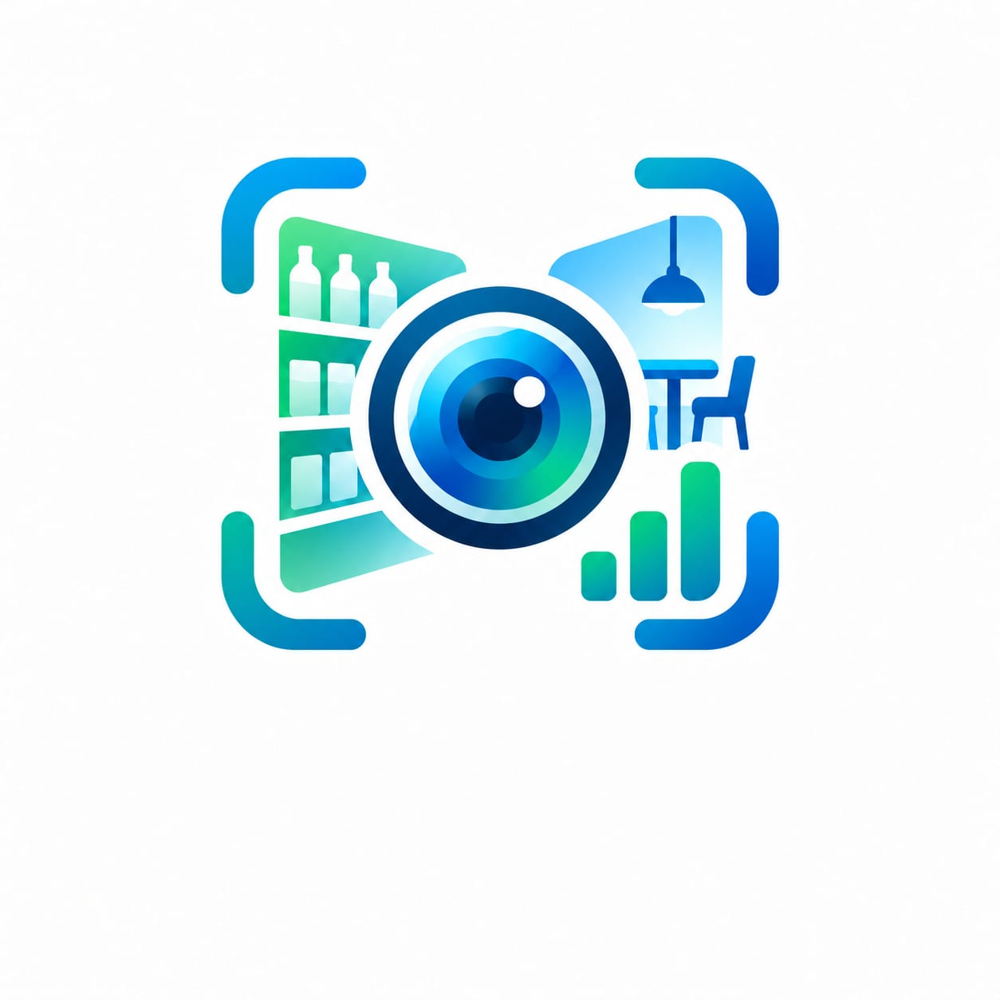
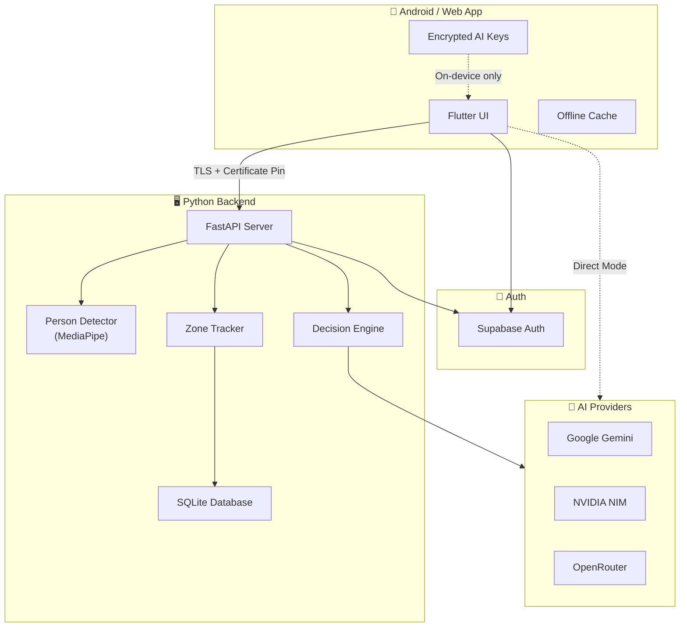
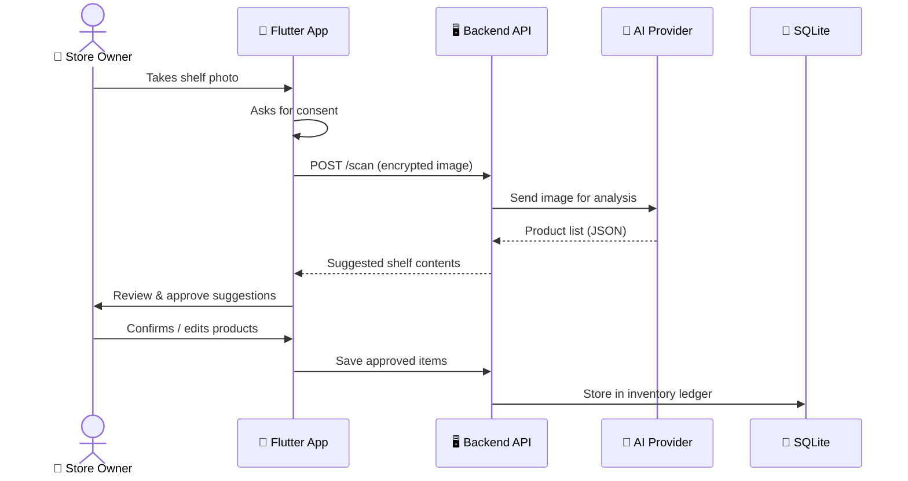
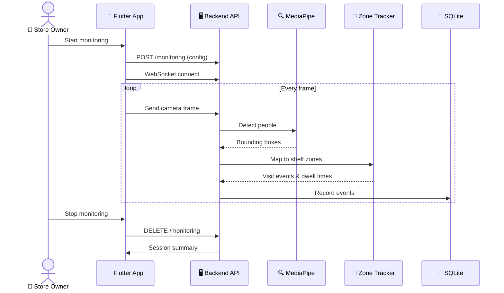
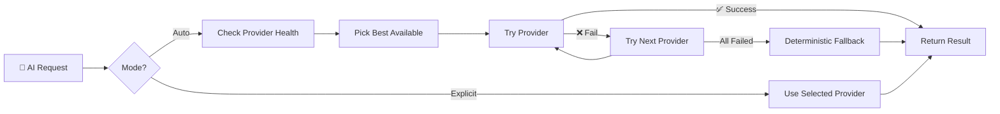
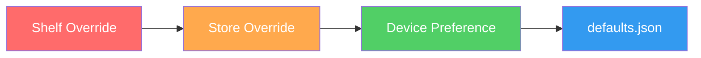

<p align="center">
  
</p>

<h1 align="center">ShelfSight</h1>

<p align="center">
  <strong>AI-powered retail shelf monitoring for small and mid-size stores</strong>
</p>

<p align="center">
  <a href="#-what-is-shelfsight">What is it?</a> •
  <a href="#-key-features">Features</a> •
  <a href="#-how-it-works">How it Works</a> •
  <a href="#-tech-stack">Tech Stack</a> •
  <a href="#-getting-started">Get Started</a> •
  <a href="#-project-structure">Project Structure</a> •
  <a href="#-api-endpoints">API</a> •
  <a href="#-development">Development</a>
</p>

<p align="center">
  
  
  
  
  
  
  
</p>

---

## 📖 What is ShelfSight?

**ShelfSight** is a smart retail assistant that helps store owners understand what's happening on their shelves — using just a phone camera and AI.

> **Think of it like this:** You point your phone at a shelf → AI identifies the products → the system tracks visits, dwell time, and stock levels → you get actionable recommendations.

| Problem | ShelfSight Solution |
|---|---|
| 🤷 "Which shelves get the most attention?" | Zone visit tracking with dwell time |
| 📦 "Is anything running low?" | Inventory monitoring with low-stock alerts |
| 🧠 "What should I restock or rearrange?" | AI-powered shelf recommendations |
| 📊 "How is my store performing?" | Real-time analytics dashboard with CSV export |
| 🔐 "Is my data safe?" | End-to-end TLS, Supabase Auth, encrypted keys |

---

## ✨ Key Features

### 📱 Mobile App (Flutter)

- **Shelf Scanner** — Point, snap, and let AI identify products on shelves
- **Live Monitoring** — Real-time person detection and zone tracking via WebSocket
- **Dashboard** — Overview of stores, shelves, inventory, and alerts
- **Analytics** — Visit counts, dwell times, shelf exposure, with date filters & CSV export
- **AI Recommendations** — Evidence-based restocking and rearrangement suggestions
- **Multi-Store** — Manage multiple stores, floors, and shelf zones
- **Direct AI Mode** — Use your own AI keys (Gemini/NIM/OpenRouter) without needing a backend
- **Offline Support** — Core features work without internet; syncs when reconnected

### 🖥️ Backend Server (Python/FastAPI)

- **Secure API** — Token-verified, rate-limited, owner-scoped endpoints
- **Vision Pipeline** — Multi-provider AI routing (Gemini, NVIDIA NIM, OpenRouter)
- **Person Detection** — MediaPipe-based zone tracking
- **Decision Engine** — Deterministic + AI-powered shelf recommendations
- **Local-First** — Runs on your PC with SQLite; no cloud account needed
- **Cloud-Ready** — Optional Google Cloud Run deployment

---

## 🔄 How it Works

### System Architecture



### Data Flow: Shelf Scan



### Data Flow: Live Monitoring



### AI Provider Routing



---

## 🛠️ Tech Stack

| Layer | Technology | Purpose |
|---|---|---|
| **Mobile App** | Flutter (Dart) | Cross-platform UI (Android, Web) |
| **Backend** | Python + FastAPI | REST API + WebSocket server |
| **Database** | SQLite | Local-first data storage |
| **Auth** | Supabase Auth | User sign-in & token verification |
| **AI Vision** | Gemini / NVIDIA NIM / OpenRouter | Product identification from shelf photos |
| **Person Detection** | MediaPipe + OpenCV | Track people near shelves |
| **Deployment** | Docker + Cloud Run | Optional cloud hosting |
| **Build Tools** | uv (Python), Flutter CLI | Dependency & build management |

---

## 🚀 Getting Started

### Prerequisites

- **Android phone** (or web browser)
- **Windows PC** on the same Wi-Fi as your phone
- **Python 3.12+** and [uv](https://docs.astral.sh/uv/)
- **Flutter SDK** (for building the app)
- A free **Supabase** project (for sign-in)

### Step 1 — Set Up Supabase

1. Create a free project at [supabase.com](https://supabase.com)
2. Go to **Auth → URL Configuration**
3. Add `com.shelfsight.app://auth-callback` as an allowed redirect

### Step 2 — Configure the App

```bash
# Copy the example config and fill in your Supabase keys
cp config/local.example.json config/local.json
```

Edit `config/local.json`:
```json
{
  "SUPABASE_URL": "https://your-project.supabase.co",
  "SUPABASE_PUBLISHABLE_KEY": "your-public-anon-key"
}
```

### Step 3 — Configure the Server

```bash
cp server/.env.example server/.env
```

Edit `server/.env`:
```env
SHELFSIGHT_SUPABASE_URL=https://your-project.supabase.co
SHELFSIGHT_SUPABASE_PUBLISHABLE_KEY=your-public-anon-key

# Optional: Configure an AI vision provider
SHELFSIGHT_VISION_PROVIDER=nvidia-nim       # or "gemini" or "openai-compatible"
SHELFSIGHT_VISION_API_KEY=your-key
SHELFSIGHT_VISION_MODEL=your-model-id
```

### Step 4 — Start the Server

```powershell
./scripts/Start-Server.ps1
```

The server prints its HTTPS address and creates `runtime/pairing.json` with the pairing details.

### Step 5 — Build & Pair the App

```powershell
./scripts/Build-App.ps1
```

1. Install the APK on your phone
2. Sign in with your Supabase account
3. Tap **Pair your laptop**
4. Enter the address, fingerprint, and pairing code from `runtime/pairing.json`

> **💡 Tip:** Phone and PC must be on the same private Wi-Fi. If Windows Firewall blocks the connection, allow TCP port 8443 on the **Private** profile only.

### Standalone Mobile Mode (Android/iOS default)

Stores, stock, calibration, visits and recommendations can live entirely on your phone:

1. Enter a Gemini, NVIDIA NIM or OpenRouter API key on onboarding.
2. Choose **Start Standalone Mobile Mode**. No server URL or cloud account is required.
3. Create your store, count stock, place shelves and calibrate camera zones. On-device ML Kit monitoring uses no AI tokens; local SQLite retains records after restart.
4. Use internet for direct AI scans and Open Food Facts lookup; local operations work offline.

ML Kit pose confirmation follows the prominent person and may miss crowds or obscured feet. Sub-100 ms inference and physical-device airplane-mode acceptance remain unverified. See [standalone architecture, limits and device checks](docs/STANDALONE_MOBILE.md). Optional remote mode retains separate server data and does not automatically synchronize the local ledger.

---

## 📂 Project Structure

```
ShelfSight/
├── app/                        # 📱 Flutter mobile & web app
│   ├── lib/
│   │   ├── core/               #    Business logic & AI routing
│   │   ├── screens/            #    UI screens (dashboard, scan, analytics...)
│   │   ├── vision/             #    Camera & monitoring logic
│   │   └── widgets/            #    Reusable UI components
│   ├── assets/
│   │   ├── defaults.json       #    Shared config (app + server)
│   │   └── l10n/               #    Translations (English)
│   └── test/                   #    Widget & unit tests + golden images
│
├── server/                     # 🖥️ Python backend
│   ├── shelfsight/
│   │   ├── api.py              #    FastAPI routes & WebSocket
│   │   ├── providers.py        #    AI provider implementations
│   │   ├── vision_compatible.py#    OpenAI-compatible vision adapter
│   │   ├── laya_router.py      #    Decision routing service
│   │   ├── tracking.py         #    Zone visit & dwell tracking
│   │   ├── analytics.py        #    Stats computation & CSV export
│   │   ├── db.py               #    SQLite database layer
│   │   └── config.py           #    Business configuration
│   └── tests/                  #    Pytest test suite
│
├── scripts/                    # ⚡ Build & deploy helpers
│   ├── Start-Server.ps1        #    Launch local server
│   ├── Build-App.ps1           #    Build Flutter APK
│   └── Deploy-CloudRun.ps1     #    Deploy to Google Cloud Run
│
├── docs/                       # 📚 Documentation
│   ├── AI_ROUTING.md           #    AI provider routing details
│   ├── CLOUD_DEPLOYMENT.md     #    Hosting & deployment guide
│   └── CONTRACT.md             #    Implementation contract
│
├── config/                     #    App configuration files
├── runtime/                    #    Server runtime data (gitignored)
├── Dockerfile                  #    Container image for Cloud Run
└── README.md                   #    ← You are here!
```

---

## 🌐 API Endpoints

### Stores & Inventory

| Method | Endpoint | What it does |
|---|---|---|
| `POST` | `/v1/stores` | Create a new store |
| `GET` | `/v1/stores` | List your stores |
| `GET` | `/v1/stores/{id}` | Get store details |
| `PATCH` | `/v1/stores/{id}` | Update store settings |
| `DELETE` | `/v1/stores/{id}` | Delete a store |
| `POST` | `/v1/stores/{id}/shelves` | Add a shelf |
| `POST` | `/v1/stores/{id}/products` | Add a product |
| `POST` | `/v1/stores/{id}/items` | Add inventory item |

### Scanning & Monitoring

| Method | Endpoint | What it does |
|---|---|---|
| `POST` | `/v1/stores/{id}/scan` | Scan a shelf photo with AI |
| `POST` | `/v1/stores/{id}/monitoring` | Start live monitoring session |
| `DELETE` | `/v1/stores/{id}/monitoring` | Stop monitoring |
| `WebSocket` | `/v1/stores/{id}/stream` | Real-time frame streaming |

### Analytics & Decisions

| Method | Endpoint | What it does |
|---|---|---|
| `GET` | `/v1/stores/{id}/analytics` | Get visit, dwell & inventory stats |
| `GET` | `/v1/stores/{id}/analytics/export` | Download CSV report |
| `POST` | `/v1/stores/{id}/decisions` | Get AI shelf recommendations |

### Auth & Health

| Method | Endpoint | What it does |
|---|---|---|
| `POST` | `/v1/pair` | Pair phone with PC (one-time code) |
| `GET` | `/v1/session` | Check current session |
| `DELETE` | `/v1/session` | Sign out |
| `GET` | `/health` | Server health check |

---

## 🧪 Development

### Run Server Tests

```bash
cd server
uv sync --extra dev
uv run pytest --cov=shelfsight     # Run tests with coverage
uv run ruff check shelfsight tests  # Lint check
```

### Run App Tests

```bash
cd app
flutter pub get
flutter analyze                     # Static analysis
flutter test                        # Unit & widget tests
```

### Configuration

All business config lives in one file: [`app/assets/defaults.json`](app/assets/defaults.json)

Both the Flutter app and Python server read from this file. It defines:
- Default settings and validation rules
- AI provider profiles and model IDs
- Store types (grocery, clothing, electronics, pharmacy...)
- Decision thresholds and capabilities

Settings follow a priority chain:



---

## ☁️ Optional: Cloud Deployment

Don't want to run a local server? Deploy to **Google Cloud Run**:

```powershell
./scripts/Deploy-CloudRun.ps1 -ProjectId 'your-gcp-project-id'
```

Then in the app, choose **Hosted API** and enter your Cloud Run URL.

> **⚠️ Note:** Cloud Run demo storage is ephemeral — data may reset on restarts. For persistent storage, mount a durable volume at `SHELFSIGHT_RUNTIME_DIR`.

See the full guide: [Cloud Deployment](docs/CLOUD_DEPLOYMENT.md)

---

## 🔒 Security

- **TLS everywhere** — Local server uses HTTPS with certificate pinning
- **One-time pairing** — Phone pairs with PC using a single-use code
- **Supabase Auth** — Industry-standard JWT-based authentication
- **Encrypted key storage** — AI API keys are encrypted on-device (AES-GCM on web, Keystore on Android)
- **Owner-scoped data** — You can only see your own stores and data
- **No secrets in the app** — Server AI keys stay on the server; never bundled in the APK
- **Rate limiting** — API requests are throttled to prevent abuse
- **Input validation** — All inputs are validated; CSV exports are formula-injection safe

---

## ⚠️ Known Limitations

This is a **demo/prototype**. Keep in mind:

- **No sales tracking** — Pickup, put-back, and sales conversion are not measured
- **Visits ≠ Customers** — Zone visits are counted, not unique people or purchases
- **Camera accuracy varies** — AI identification depends on lighting, angle, and product visibility
- **Single-instance storage** — No multi-server sync; one SQLite database at a time
- **Firebase migration** — Old Firebase users need to create new Supabase accounts

---

## 📄 License

See [THIRD_PARTY_NOTICES.md](THIRD_PARTY_NOTICES.md) for third-party licenses.

---

<p align="center">
  Built with ❤️ using Flutter, FastAPI, and AI
</p>
